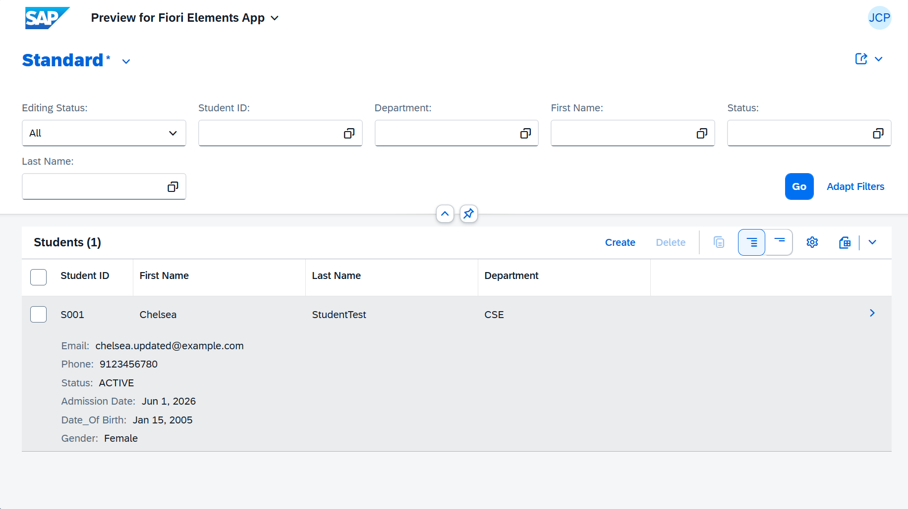
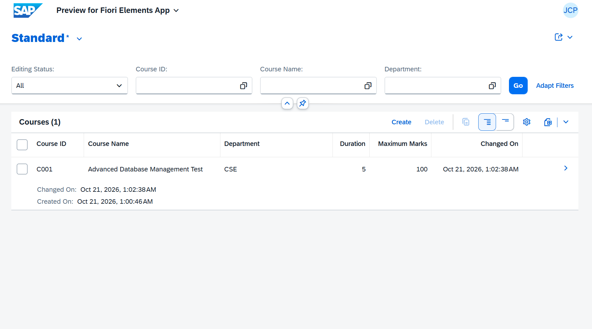
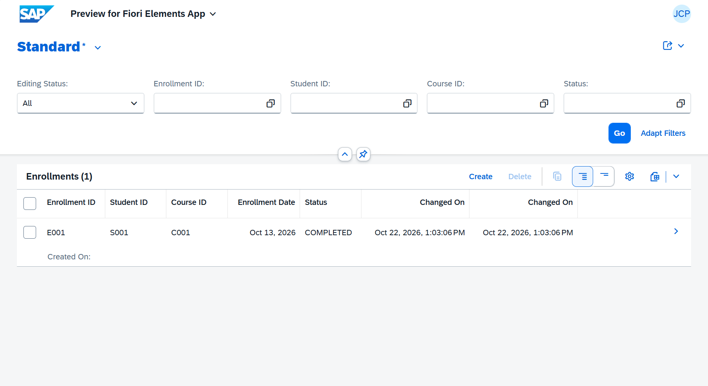
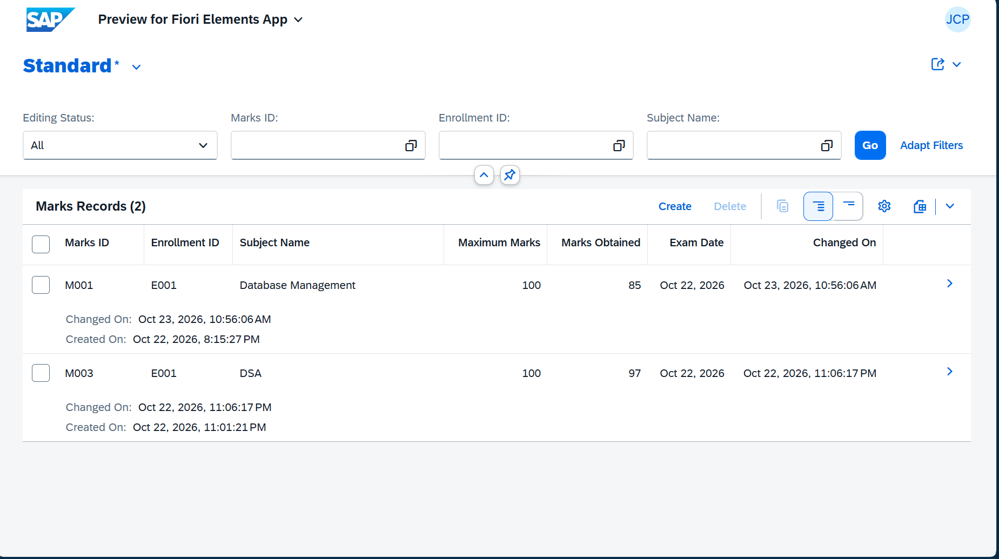
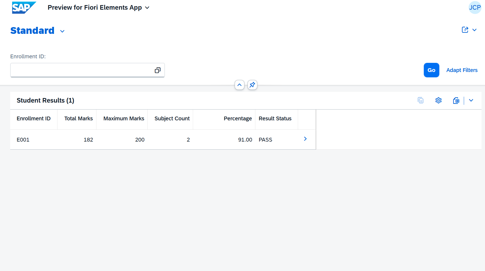

# Student Management System | SAP ABAP Cloud & RAP

A Student Management System developed using **SAP ABAP Cloud, RESTful Application Programming Model (RAP), Core Data Services (CDS), OData V4, and SAP Fiori Elements**.

The application manages students, courses, enrollments, examination marks, and academic results through a web-based interface.

## Technologies Used

- SAP ABAP Cloud
- Eclipse IDE with ABAP Development Tools (ADT)
- RESTful Application Programming Model (RAP)
- Core Data Services (CDS)
- SAP Fiori Elements
- OData V4
- SAP HANA

## Key Features

- **Student Management:** Create, view, update, and delete student records.
- **Course Management:** Manage course details, departments, duration, and maximum marks.
- **Enrollment Management:** Link students with courses and track enrollment status.
- **Marks Management:** Record and update examination marks.
- **Automatic Results:** Calculate total marks, percentages, and PASS/FAIL status.
- **Data Validation:** Reject invalid references, negative marks, marks above the maximum, and duplicate subjects within an enrollment.
- **Deletion Protection:** Prevent deletion of students, courses, or enrollments that have dependent records.
- **Draft Support:** Edit and validate records using SAP RAP draft handling.

## Application Screenshots

### Student Management

### Course Management

### Enrollment Management

### Examination Marks

### Academic Results

## Project Architecture

SAP Fiori Elements → OData V4 → RAP Service Definition → CDS Views and RAP Business Objects → SAP HANA Database

### Database Tables

- `ZCHELSEA_STU`
- `ZCHELSEA_COURSE`
- `ZCHELSEA_ENROLL`
- `ZCHELSEA_MARKS`

### Service Definition

`ZCHELSEA_STUDENT_RAP_SRV`

### OData V4 Service Binding

`ZCHELSEA_STUDENT_UI_V4`

## Testing and Results

The application was tested using SAP Fiori Elements for CRUD operations, validation rules, deletion restrictions, and automatic result calculations.

| Metric | Test Result |
|---|---|
| Enrollment ID | E001 |
| Subjects | 2 |
| Total Marks | 182 / 200 |
| Percentage | 91% |
| Result | PASS |

## Project Status

Core application functionality has been implemented and tested in the SAP ABAP Cloud development environment.

Additional production-readiness work includes database warning review, concurrency-safe duplicate prevention, and deployment and security review.
